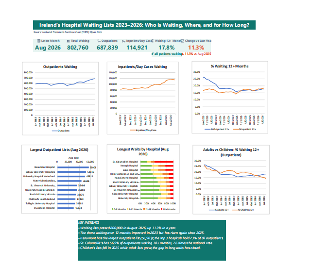

# 🏥 Ireland's Hospital Waiting Lists 2023–2026: Who Is Waiting, Where, and for How Long?

An analysis of Ireland's public hospital waiting lists from January 2023 to August 2026, using official monthly data from the National Treatment Purchase Fund (NTPF). Built with **Power Query** and **Excel**.



---

## 💡 Why I Built This

Hospital waiting lists are one of the biggest public issues in Ireland, and almost everyone knows someone who is waiting. After my first project on Ireland's electricity grid, I wanted a second project in a different sector that focused on Excel, the tool most analyst jobs use every day. My goal was to go beyond the headline number and understand who is waiting, in which hospitals, and for how long.

---

## 📌 Business Questions

1. How have waiting lists changed from 2023 to 2026?
2. What share of patients wait more than 12 months?
3. Which hospitals have the largest waiting lists?
4. Which hospitals have the longest waits?
5. How do adults and children compare?

---

## 🔑 Key Findings

| # | Finding |
|---|---|
| 1 | **Waiting lists passed 800,000 patients** in August 2026 (802,760), up **11.3%** in one year. The outpatient list fell to a low of 562,038 in December 2023, then grew **22%** to 687,839. |
| 2 | **Long waits improved in 2023 but are rising again.** The share of outpatients waiting 12+ months fell from about 26% (Jan 2023) to about 16% (early 2025), then rose to 17.7%. For inpatient/day case it reached **18.5%** in August 2026, the highest in the period. |
| 3 | **Beaumont Hospital now has the largest outpatient list** (56,903), up 22% in eight months, overtaking Galway University Hospitals. The top 3 hospitals hold 23% of all outpatients; for inpatient/day case, the top 3 hold **32.6%**. |
| 4 | **The biggest list is not the same as the longest waits.** At St. Columcille's Hospital, **56.9%** of outpatients had waited over 18 months, **7.6 times** the national rate of 7.5%, with more long waiters than Galway despite a list five times smaller. |
| 5 | **Children's lists fell in 2025 while adult lists grew.** The children's inpatient/day case list fell 9.6% while the adult list grew 16.0%, and the share of children waiting 12+ months fell from 23.7% to 17.0%. By 2026, adults waited longer than children on the outpatient list. |

---

## 🛠️ Tools and Workflow

```
NTPF CSV files (8)  →  Power Query (combine & clean)  →  Excel (formulas, pivots)  →  Excel dashboard
 2 lists × 4 years       Irish dates, blank rows,           5 analyses, input cells     KPI tiles + 6 charts
                         new columns, append
```

| Tool | Used for |
|---|---|
| **Power Query** | Combining 8 CSV files from folders, fixing dates, removing blank rows, adding calculated columns, appending both lists |
| **Excel** | Structured tables, dynamic array formulas, pivot tables, charts and the final dashboard |

---

## 📊 Data

- **Source:** [NTPF Open Data](https://www.ntpf.ie/waiting-list-data/open-data/), Outpatient (OP) and Inpatient/Day Case (IPDC) waiting lists by hospital
- **Period:** January 2023 to August 2026 (monthly snapshots)
- **Coverage:** 44–45 public hospitals, split by adult and child

The raw files are not included in this repository. Download them from the link above to reproduce the project.

---

## 🧹 Data Preparation Decisions

| Issue | Decision |
|---|---|
| **8 separate yearly files** | Combined automatically with Power Query's folder connector, so new files can be added with one refresh |
| **Dates in Irish format** (day/month/year) | Converted using the English (Ireland) locale, so dates like 26/01/2023 are read correctly |
| **Blank rows** at the end of the CSV files | Removed |
| **Snapshot dates** vary within each month (e.g. 18/12/2025) | Added a clean Month column (start of month) |
| **Time bands sometimes differ from Total by 1–2 patients** | NTPF applies statistical disclosure control to protect patient confidentiality. I used the Total column for totals (it matches official figures) and the bands for percentages |
| **Two separate lists** | Added a List Type column and appended both into one table |

---

## ✅ Validation

Monthly totals were checked against NTPF's official press releases and matched exactly:

| Month | Outpatient | Inpatient/Day Case |
|---|---|---|
| January 2025 | 569,249 ✅ | 94,456 ✅ |
| December 2025 | 611,987 ✅ | 107,181 ✅ |

---

## 📈 Excel Skills Demonstrated

- **Dynamic array formulas:** `SORT`, `UNIQUE`, `FILTER`, `HSTACK`, `TAKE` and spill references (`A2#`)
- **Conditional aggregation:** `SUMIFS` with multiple criteria and structured table references
- **Interactive input cells:** change one cell to switch the month or list, and every table and chart updates
- **Date functions:** `EDATE` for year-on-year comparison
- **Pivot tables** with filters, sorting and Top 10 value filters
- **Dashboard design:** KPI tiles that update automatically, headline chart titles and a consistent colour theme

**Analytical choice:** when ranking hospitals by long waits, I only included hospitals with at least 1,000 patients, because very small lists can produce misleading percentages.

---

## 🧩 Challenges and What I Learned

**1. Excel online cannot combine folders**
- **Problem:** My college only provides Excel online, which does not support Power Query's "From Folder" connector.
- **What I did:** I used Power Query inside Power BI Desktop, which uses the same engine, then copied the clean table into Excel online.
- **What I learned:** When a tool has a limit, look for another tool that does the same job.

**2. Data that looked missing**
- **Problem:** After combining the files, the filter list only showed 2023 and 2024.
- **What I did:** I found that Power Query's preview only shows the first 1,000 rows. After loading more, all four years were there.
- **What I learned:** A preview is not the full dataset, so check before assuming data is missing.

**3. A broken chart**
- **Problem:** My stacked bar chart showed one wrong series instead of four waiting bands.
- **What I did:** I found that Excel online does not handle charts from separate selections well. I changed my formula to place the chart columns side by side, so I could select one block.
- **What I learned:** How data is arranged affects how easy it is to visualise.

**4. Comparing percentages correctly**
- **Problem:** I first described 56.9% vs 7.5% as "49% times higher".
- **What I did:** I learned the difference between percentage points (56.9 − 7.5 = 49.4 points) and ratios (56.9 ÷ 7.5 = 7.6 times).
- **What I learned:** Choosing the right comparison words makes findings accurate and easy to understand.

---

## ⚠️ Limitations

- The inpatient/day case list does **not include GI endoscopy**, which NTPF publishes separately.
- Each month is a **snapshot** on a single date, not an average across the month.
- The data shows **how many** people are waiting and for how long, but not **why** waiting lists change (for example, staffing, funding or validation exercises). Explanations in the findings are possible causes, not proven ones.

---

## 📂 Repository Structure

```
irish-hospital-waiting-lists/
├── README.md
├── excel/
│   ├── hospital_waiting_lists.xlsx      # Data, analysis sheets and dashboard
│   └── hospital_waiting_lists.pdf       # Dashboard as PDF
├── powerbi/
│   └── hospital_waiting_lists.pbix      # Power Query data preparation
├── power_query/
│   ├── outpatient.m                     # Power Query M code (readable on GitHub)
│   ├── inpatient_daycase.m
│   └── waiting_list.m
└── images/
    └── dashboard.png
```

---

## 👤 Author

**Nouman Ahmad**, MSc Business Analytics, Dublin Business School
[LinkedIn](https://linkedin.com/in/noumangujjar) · [My other project: Irish Electricity Grid Analysis](https://github.com/Numan69/irish-grid-renewables-analysis)
